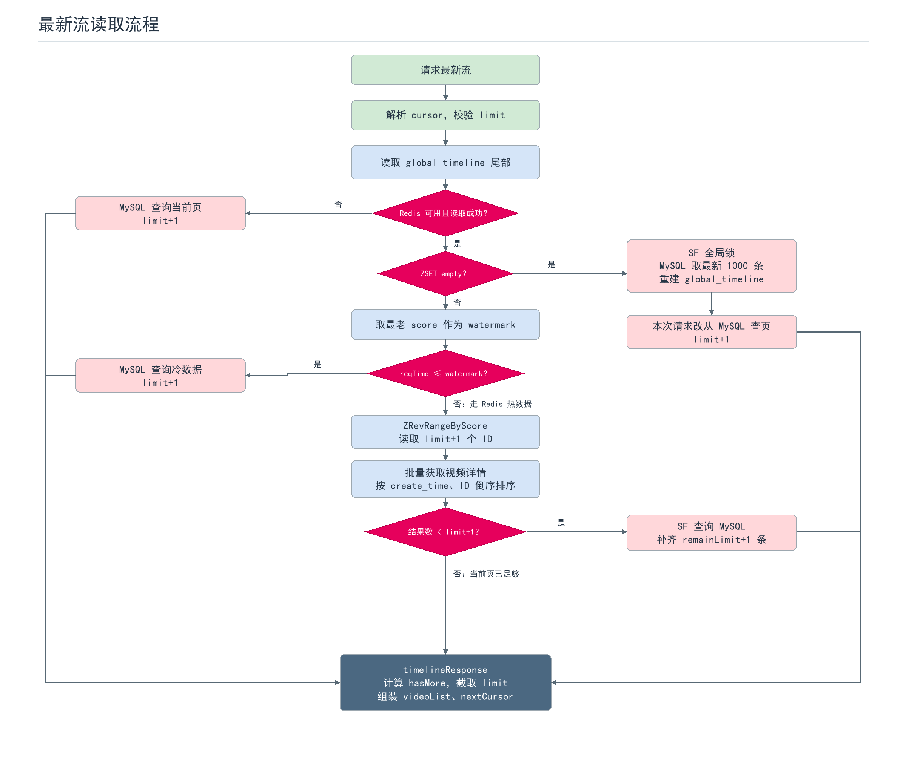
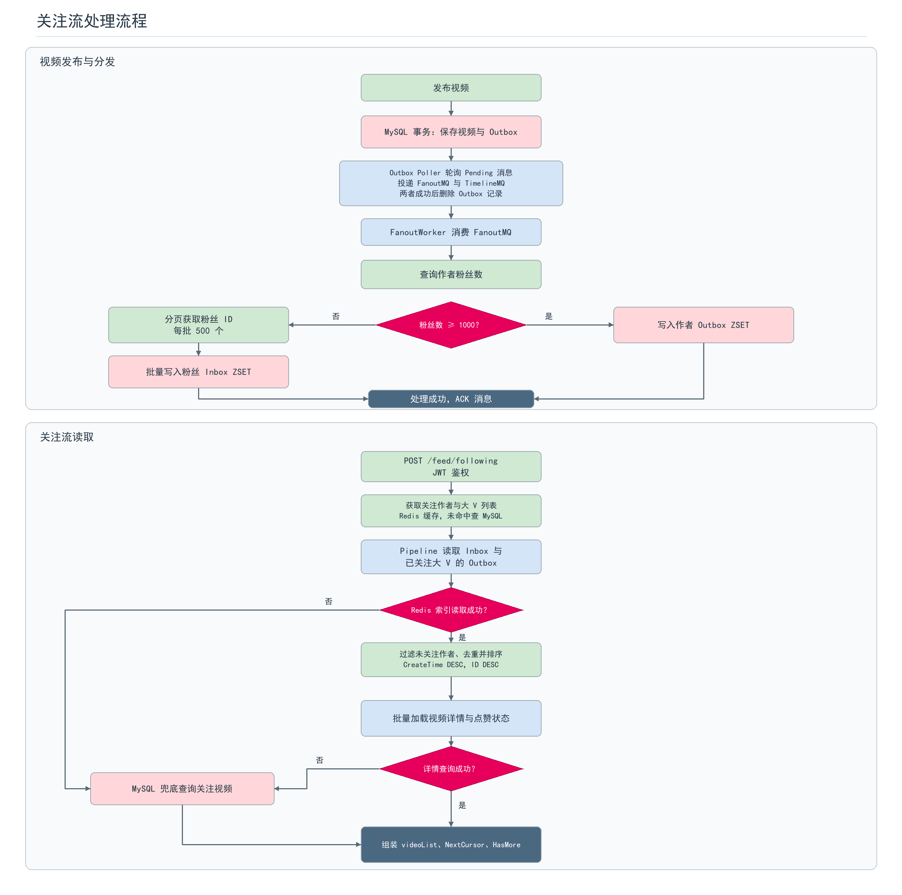
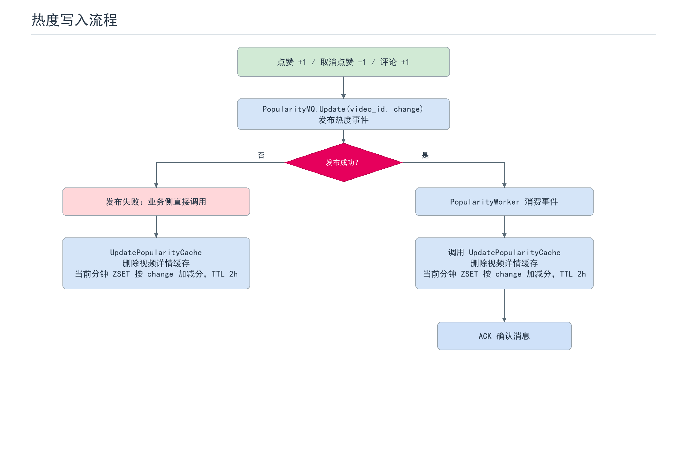

# kirfeed

基于 Go 和 Gin 的短视频 Feed 后端项目，提供账号、视频发布、点赞评论、关注关系以及最新、热门和关注 Feed。使用 MySQL 持久化数据，Redis 加速 Feed 与缓存查询，RabbitMQ 异步处理互动和 Feed 更新。

## 功能

| 模块 | 功能 |
| --- | --- |
| 账号 | 注册、登录、Access Token 刷新、改名、密码修改、头像上传、个人资料更新 |
| 视频 | MP4 上传、封面上传、视频发布、详情查询、删除 |
| 互动 | 点赞、取消点赞、查询点赞状态、查看已点赞视频；发表评论、删除评论、查看评论 |
| 关注 | 关注、取消关注、粉丝和关注列表、关系数量统计 |
| Feed | 最新 Feed、热门 Feed、关注 Feed，支持游标分页 |
| 异步处理 | RabbitMQ Worker 处理点赞、评论、社交事件、热度更新和 Feed 时间线/扇出任务 |

## 技术栈

- Go、Gin、GORM
- MySQL：业务数据
- Redis：Feed 索引、缓存及相关异步处理
- RabbitMQ：业务事件与 Worker 消费

## 启动

项目使用 Go `1.26.1` 或更新版本。先启动 MySQL、Redis 和 RabbitMQ：

```bash
docker compose up -d mysql redis rabbitmq
```

Compose 会将 MySQL 映射到宿主机 `3307`，Redis 使用 `6379`，RabbitMQ 使用 `5672`；管理台地址为 `http://localhost:15672`，默认开发账号为 `admin` / `666666`。如用于非本地开发环境，请修改 `docker-compose.yaml` 和配置文件中的默认凭据。

在 PowerShell 中分别打开两个终端，启动 API 和 Worker：

```powershell
$env:CONFIG_PATH = "configs/config.docker.yaml"
go run ./cmd
```

```powershell
$env:CONFIG_PATH = "configs/config.docker.yaml"
go run ./cmd/worker
```

API 默认监听 `8080`。可以访问 `GET http://localhost:8080/ping` 检查服务，正常时返回 `{"message":"pong"}`。API 启动时会自动迁移数据库表。

配置文件：

- `configs/config.yaml`：连接本机 MySQL `3306`、Redis `6379` 和 RabbitMQ `5672`。
- `configs/config.docker.yaml`：连接上述 Compose 映射的 MySQL `3307`。
- 可通过 `CONFIG_PATH` 指定配置文件；未设置时默认读取 `configs/config.yaml`。

## 接口清单

除特别说明外，接口均为 `POST`，请求体使用 JSON。JWT 接口通过 `Authorization: Bearer <token>` 传入 Access Token。Feed 的软鉴权接口允许匿名访问；如果请求携带 Token，则会校验 Token。

### 健康检查

| 方法 | 路径 | 鉴权 | 说明 |
| --- | --- | --- | --- |
| GET | `/ping` | 否 | 健康检查，返回 `pong` |

### 账号 `/account`

| 方法 | 路径 | 鉴权 | 说明 |
| --- | --- | --- | --- |
| POST | `/register` | 否 | 注册账号 |
| POST | `/login` | 否 | 登录并获取 Access Token 和 Refresh Token |
| POST | `/refresh` | 否 | 使用 Refresh Token 刷新 Access Token |
| POST | `/changePassword` | 否 | 修改密码 |
| POST | `/findByID` | 否 | 按 ID 查询用户 |
| POST | `/findByUsername` | 否 | 按用户名查询用户 |
| POST | `/logout` | JWT | 登出 |
| POST | `/rename` | JWT | 修改用户名 |
| POST | `/uploadAvatar` | JWT | 上传头像（jpg/jpeg/png/webp，最大 10 MB） |
| POST | `/updateProfile` | JWT | 更新个人资料 |

### 视频 `/video`

| 方法 | 路径 | 鉴权 | 说明 |
| --- | --- | --- | --- |
| POST | `/publish` | JWT | 发布视频 |
| POST | `/uploadVideo` | JWT | 上传 MP4 视频（最大 200 MB） |
| POST | `/uploadCover` | JWT | 上传封面（jpg/jpeg/png/webp，最大 10 MB） |
| POST | `/delete` | JWT | 删除视频 |
| POST | `/getDetail` | 否 | 查询视频详情 |

### 点赞 `/video`

| 方法 | 路径 | 鉴权 | 说明 |
| --- | --- | --- | --- |
| POST | `/like` | JWT | 点赞 |
| POST | `/unlike` | JWT | 取消点赞 |
| POST | `/isLiked` | JWT | 查询是否已点赞 |
| POST | `/listMyLikedVideos` | JWT | 查询我赞过的视频 |

### 评论 `/comment`

| 方法 | 路径 | 鉴权 | 说明 |
| --- | --- | --- | --- |
| POST | `/listAll` | 否 | 查询视频评论 |
| POST | `/publish` | JWT | 发表评论 |
| POST | `/delete` | JWT | 删除评论 |

### 关注 `/social`

| 方法 | 路径 | 鉴权 | 说明 |
| --- | --- | --- | --- |
| POST | `/follow` | JWT | 关注用户 |
| POST | `/unfollow` | JWT | 取消关注 |
| POST | `/getFollowers` | JWT | 查询粉丝列表 |
| POST | `/getFollowees` | JWT | 查询关注列表 |
| POST | `/getCounts` | JWT | 查询粉丝数和关注数 |

### Feed `/feed`

| 方法 | 路径 | 鉴权 | 说明 |
| --- | --- | --- | --- |
| POST | `/latest` | 软鉴权 | 查询最新视频 Feed |
| POST | `/listByPopularity` | 软鉴权 | 查询热门 Feed |
| POST | `/following` | JWT | 查询关注 Feed |

视频、头像和封面上传接口通过 `multipart/form-data` 接收文件；其他接口按 JSON 请求处理。

## 项目结构

```text
cmd/                 API 与 Worker 程序入口
configs/             本地和 Compose 开发配置
internal/account/    账号与认证相关业务
internal/video/      视频、点赞和评论
internal/social/     关注关系
internal/feed/       Feed 查询与缓存
internal/infra/      数据库、缓存、JWT 和消息队列基础设施
internal/worker/     异步消息消费者与后台任务
picture/             Feed 和热度流程图及生成脚本
```

## 流程图

### Feed





### 热度


